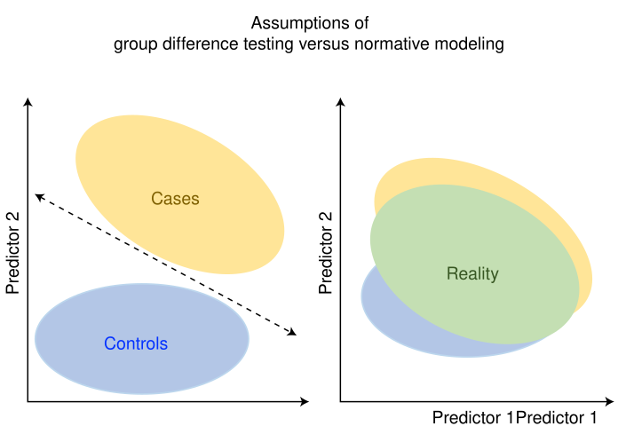
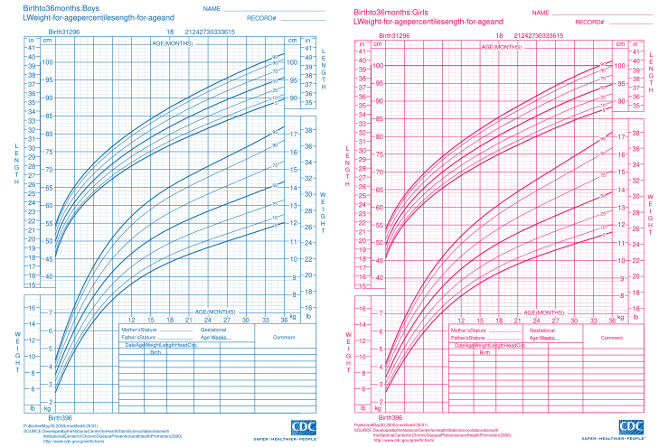
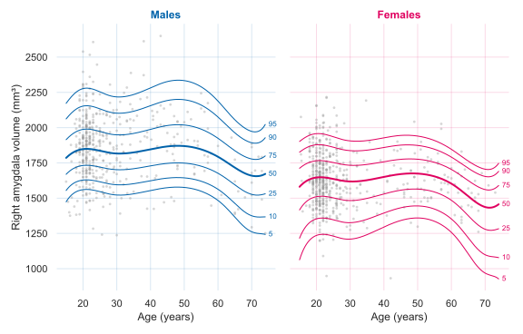
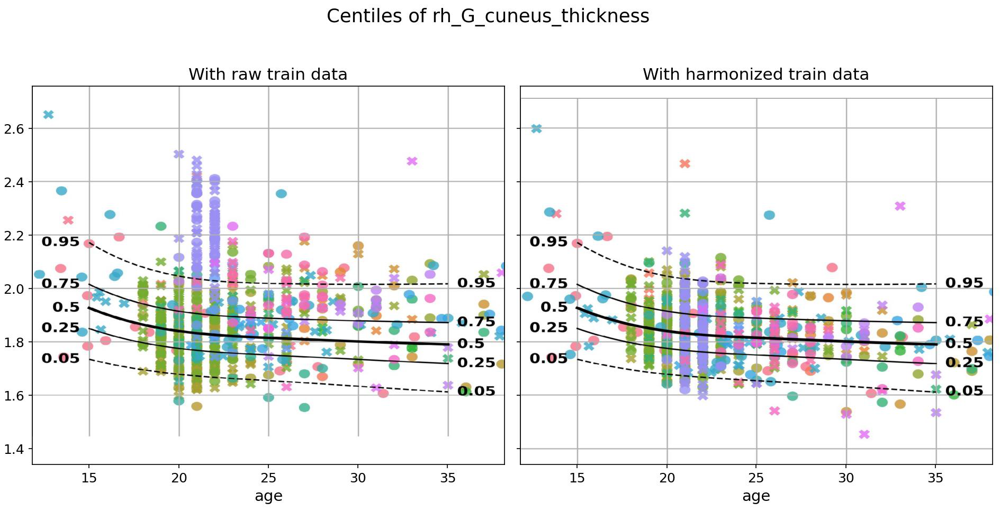

.. title:: Background

PCNtoolkit background
====================================

What is the PCNtoolkit?
****************************

The **Predictive Clinical Neuroscience (PCN) toolkit** is an open-source Python package for normative modelling. It can work with any tabular data like neuroimaging data (structural and functional MRI, diffusion MRI, MEG, EEG), cognitive scores, or epigenomic data. It is developed and maintained by the `Predictive Clinical Neuroscience lab <https://predictiveclinicalneuroscience.com/>`_ at the `Donders Institute for Brain, Cognition and Behaviour <https://www.ru.nl/donders/>`_.

The limitations of case-control studies
-----------------------------------------------------

Case-control studies compare the average patient with the average control. This assumes that each group is fairly uniform, which is often not the case. Patients with the same psychiatric or neurological diagnosis may differ from controls in different ways. Normative modelling computes a reference model based on the population and asks how each individual, rather than the group as a whole, differs from it (`Marquand et al., 2019 <https://www.nature.com/articles/s41380-019-0441-1>`_).

   *Case-control versus heterogeneity assumption (figure from* `Rutherford et al., 2022 <https://www.nature.com/articles/s41596-022-00696-5>`__\ *).*

From growth charts to brain charts
-----------------------------------------------------

The idea of normative modelling is not new in medicine. If you have kids, you might have seen normative charts being used by paediatricians. They measure the child's height and weight and plot them on a normative chart (also called growth chart) to see how a child compares with other children of the same age and sex. A child on the 50th centile is following the norm, and a child on the 5th centile is smaller than 95% of their peers. PCNtoolkit brings the same idea to the brain or other biological data.

   *Paediatric growth charts for boys and girls (figure from* `Rutherford et al., 2022 <https://www.nature.com/articles/s41596-022-00696-5>`__\ *). For both sexes, the upper centile curves show height and the lower ones show weight.*

   *A centile plot of a brain measure made with PCNtoolkit. This is a typical PCNtoolkit output and it works just like a growth chart.*

What PCNtoolkit offers
-----------------------------------------------------

PCNtoolkit offers normative models that can handle difficult phenotypes. For example phenotypes that change non-linearly with age and/or are highly skewed. 

More specifically, PCNtoolkit does normative modelling using **Bayesian models**, which have three attractive features. First, they estimate the full distribution of the data (not only the mean) which lets us say how far from the norm one person is. Second, they can build on what we already know (the so-called "prior"). This opens the door to transfer learning, i.e., a model fitted on a large reference dataset can serve as the prior for a new, smaller dataset. Third, they keep apart two kinds of uncertainty. These are how unsure the model itself is (for example, at ages with little data) and how much people naturally vary.

The toolkit provides two Bayesian models. Both predict a full distribution for each subject and estimate both centiles and deviation scores (z-scores).

**Table 1: PCNtoolkit models**

=================  =================================  =============================================================================================
**Class**          **Description**                    **Reference**
-----------------  ---------------------------------  ---------------------------------------------------------------------------------------------
``BLR``            Bayesian Linear Regression         `Fraza et al 2021 <https://doi.org/10.1016/j.neuroimage.2021.118715>`_
``HBR``            Hierarchical Bayesian Regression   `de Boer et al 2024 <https://doi.org/10.1162/imag_a_00132>`_
=================  =================================  =============================================================================================

A way to check how well your model was fitted is to look at the **evaluation metrics** provided by PCNtoolkit.

Another feature of PCNtoolkit is that it can **harmonize** data. This is useful for large multi-site cohorts, where differences between scanners and sites can be as large as the effects you are interested in. We call such differences **batch effects**. PCNtoolkit accounts for them in the model instead of totally removing them from the data.

   *Each colour represents a different site. After harmonization, the data from all sites follow the centiles much more closely.*

We keep adding features based on what the community needs, for example:

* **Federated learning.** Clinical data often cannot be shared because of privacy concerns. So instead of collecting all the data in one place and training a new model, we adapt `existing models <https://surfdrive.surf.nl/s/Mb6mZyFmJeCaPcZ>`__ to new data without that data ever being shared (**model transfer or extension**; `Kia et al., 2022 <https://doi.org/10.1371/journal.pone.0278776>`__). Besides the PCNtoolkit (Python code), we also offer the `PCNportal <https://pcnportal.dccn.nl/>`_ a web interface for model transfer for those who prefer not to code.
* **Longitudinal modelling.** With repeated scans of the same person, we can ask whether they change over time as expected for their age (`Rehák Bučková et al., 2025 <https://elifesciences.org/reviewed-preprints/95823>`__; `Bayer et al., 2026 <https://arxiv.org/abs/2601.07591>`__).
