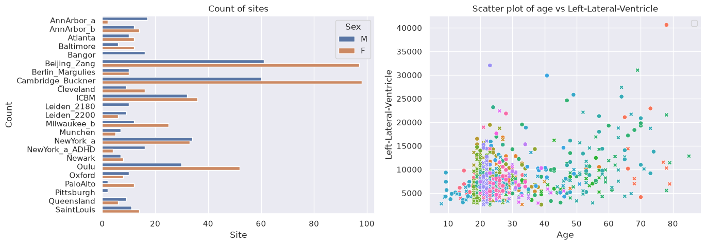
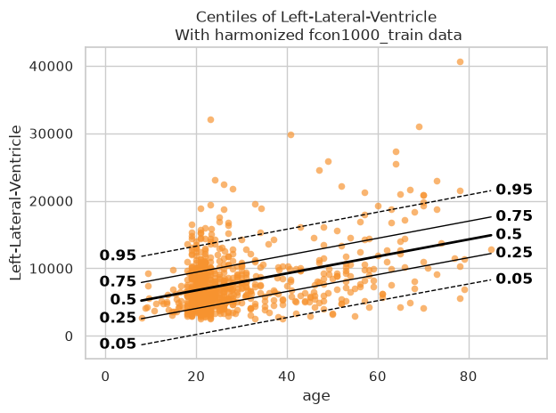
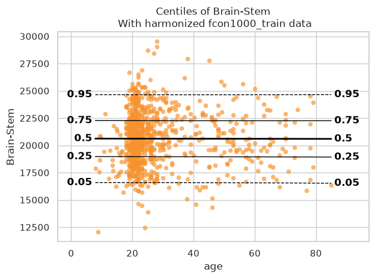
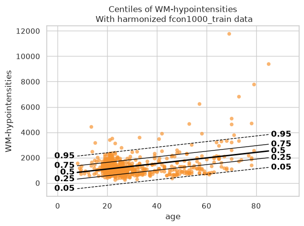
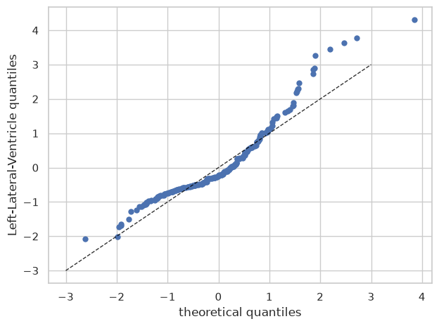
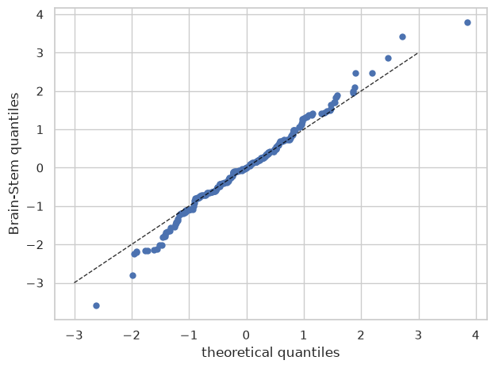
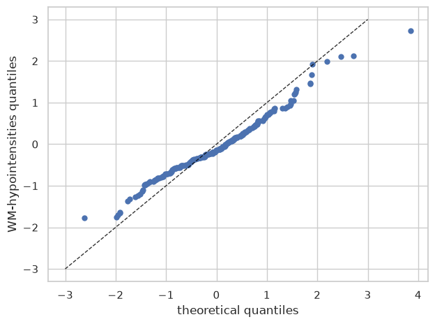

Getting started with normative modelling
========================================

.. container:: notebook-download

   :download:`Download Jupyter notebook <notebooks/00_getting_started.ipynb>`

Welcome to this tutorial notebook that will show you the very basics of
normative modeling. It’s like the “Hello World” of normative modeling.

Let’s jump right in.

Imports
~~~~~~~

.. code:: ipython3

    import warnings
    
    import matplotlib.pyplot as plt
    import pandas as pd
    import seaborn as sns
    
    import pcntoolkit.util.output
    from pcntoolkit import (
        BLR,
        NormativeModel,
        NormData,
        load_fcon1000,
        plot_centiles,
        plot_qq,
    )
    
    sns.set_style("darkgrid")
    warnings.simplefilter(action="ignore", category=FutureWarning)
    pd.options.mode.chained_assignment = None  # default='warn'
    pcntoolkit.util.output.Output.set_show_messages(False)

.. code:: text

    /tmp/ipykernel_2550/824129747.py:19: Pandas4Warning: The 'mode.chained_assignment' option is deprecated. It has had no effect since pandas 3.0, which removed the SettingWithCopyWarning it controlled. Chained assignment now emits a ChainedAssignmentError warning instead; use warnings.filterwarnings with category=ChainedAssignmentError to silence or escalate it. This option will be removed in pandas 4.0.
      pd.options.mode.chained_assignment = None  # default='warn'

Load data
---------

First we download a small example dataset from github.

.. code:: ipython3

    # Download an example dataset
    norm_data: NormData = load_fcon1000()
    # Select only these three features to model for this example
    norm_data = norm_data.sel(
        {"response_vars": ["WM-hypointensities", "Left-Lateral-Ventricle", "Brain-Stem"]}
    )
    # Train-test split
    train, test = norm_data.train_test_split()

.. code:: ipython3

    # Inspect the data
    df = train.to_dataframe()
    fig, ax = plt.subplots(1, 2, figsize=(15, 5))
    
    sns.countplot(
        data=df,
        y=("batch_effects", "site"),
        hue=("batch_effects", "sex"),
        ax=ax[0],
        orient="h",
    )
    ax[0].legend(title="Sex")
    ax[0].set_title("Count of sites")
    ax[0].set_xlabel("Site")
    ax[0].set_ylabel("Count")
    
    scatter_feature = "Left-Lateral-Ventricle"
    
    sns.scatterplot(
        data=df,
        x=("X", "age"),
        y=("Y", scatter_feature),
        hue=("batch_effects", "site"),
        style=("batch_effects", "sex"),
        ax=ax[1],
    )
    ax[1].legend([], [])
    ax[1].set_title(f"Scatter plot of age vs {scatter_feature}")
    ax[1].set_xlabel("Age")
    ax[1].set_ylabel(scatter_feature)
    
    plt.show()

Creating a Normative model
--------------------------

.. code:: ipython3

    save_dir = "/Users/stijndeboer/Projects/PCN/PCNtoolkit/examples/saves"
    model = NormativeModel(BLR(), inscaler="standardize", outscaler="standardize")

.. code:: ipython3

    model.has_batch_effect

.. code:: text

    False

Fit the model
-------------

With all that configured, we can fit the model.

The ``fit_predict`` function will fit the model, evaluate it, save the
results and plots, and return the test data with all the predictions
added.

After that, it will compute Z-scores and centiles for the test set.

All results can be found in the save directory.

.. code:: ipython3

    model.fit_predict(train, test)

.. raw:: html

    
<svg style="position: absolute; width: 0; height: 0; overflow: hidden">
    <defs>
    <symbol id="icon-database" viewBox="0 0 32 32">
    <path d="M16 0c-8.837 0-16 2.239-16 5v4c0 2.761 7.163 5 16 5s16-2.239 16-5v-4c0-2.761-7.163-5-16-5z"></path>
    <path d="M16 17c-8.837 0-16-2.239-16-5v6c0 2.761 7.163 5 16 5s16-2.239 16-5v-6c0 2.761-7.163 5-16 5z"></path>
    <path d="M16 26c-8.837 0-16-2.239-16-5v6c0 2.761 7.163 5 16 5s16-2.239 16-5v-6c0 2.761-7.163 5-16 5z"></path>
    </symbol>
    <symbol id="icon-file-text2" viewBox="0 0 32 32">
    <path d="M28.681 7.159c-0.694-0.947-1.662-2.053-2.724-3.116s-2.169-2.030-3.116-2.724c-1.612-1.182-2.393-1.319-2.841-1.319h-15.5c-1.378 0-2.5 1.121-2.5 2.5v27c0 1.378 1.122 2.5 2.5 2.5h23c1.378 0 2.5-1.122 2.5-2.5v-19.5c0-0.448-0.137-1.23-1.319-2.841zM24.543 5.457c0.959 0.959 1.712 1.825 2.268 2.543h-4.811v-4.811c0.718 0.556 1.584 1.309 2.543 2.268zM28 29.5c0 0.271-0.229 0.5-0.5 0.5h-23c-0.271 0-0.5-0.229-0.5-0.5v-27c0-0.271 0.229-0.5 0.5-0.5 0 0 15.499-0 15.5 0v7c0 0.552 0.448 1 1 1h7v19.5z"></path>
    <path d="M23 26h-14c-0.552 0-1-0.448-1-1s0.448-1 1-1h14c0.552 0 1 0.448 1 1s-0.448 1-1 1z"></path>
    <path d="M23 22h-14c-0.552 0-1-0.448-1-1s0.448-1 1-1h14c0.552 0 1 0.448 1 1s-0.448 1-1 1z"></path>
    <path d="M23 18h-14c-0.552 0-1-0.448-1-1s0.448-1 1-1h14c0.552 0 1 0.448 1 1s-0.448 1-1 1z"></path>
    </symbol>
    </defs>
    </svg>
    <pre class='xr-text-repr-fallback'>&lt;xarray.NormData&gt; Size: 87kB
    Dimensions:            (observations: 216, response_vars: 3, covariates: 1,
                            batch_effect_dims: 2, centile: 5, statistic: 13)
    Coordinates:
      * observations       (observations) int64 2kB 756 769 692 616 ... 751 470 1043
      * response_vars      (response_vars) &lt;U22 264B &#x27;WM-hypointensities&#x27; ... &#x27;Br...
      * covariates         (covariates) &lt;U3 12B &#x27;age&#x27;
      * batch_effect_dims  (batch_effect_dims) &lt;U4 32B &#x27;sex&#x27; &#x27;site&#x27;
      * centile            (centile) float64 40B 0.05 0.25 0.5 0.75 0.95
      * statistic          (statistic) &lt;U8 416B &#x27;EXPV&#x27; &#x27;Kurtosis&#x27; ... &#x27;Skewness&#x27;
    Data variables:
        subject_ids        (observations) object 2kB &#x27;Munchen_sub96752&#x27; ... &#x27;Quee...
        Y                  (observations, response_vars) float64 5kB 2.721e+03 .....
        X                  (observations, covariates) float64 2kB 63.0 ... 23.0
        batch_effects      (observations, batch_effect_dims) &lt;U17 29kB &#x27;F&#x27; ... &#x27;Q...
        Z                  (observations, response_vars) float64 5kB 0.8678 ... -...
        centiles           (centile, observations, response_vars) float64 26kB 75...
        baseline_logp      (observations, response_vars) float64 5kB -3.66 ... -2...
        logp               (observations, response_vars) float64 5kB -1.254 ... -...
        Yhat               (observations, response_vars) float64 5kB 2.041e+03 .....
        statistics         (response_vars, statistic) float64 312B 0.1501 ... 0.0...
    Attributes:
        real_ids:                       True
        is_scaled:                      False
        name:                           fcon1000_test
        unique_batch_effects:           {np.str_(&#x27;sex&#x27;): [&#x27;M&#x27;, &#x27;F&#x27;], np.str_(&#x27;sit...
        batch_effect_counts:            defaultdict(&lt;function NormData.register_b...
        covariate_ranges:               {np.str_(&#x27;age&#x27;): {&#x27;min&#x27;: 7.88, &#x27;max&#x27;: 85.0}}
        batch_effect_covariate_ranges:  {np.str_(&#x27;sex&#x27;): {&#x27;M&#x27;: {np.str_(&#x27;age&#x27;): {...</pre>

xarray.NormData

<ul class='xr-sections'><li class='xr-section-item'><input id='section-bbb19f47-576a-46f2-94e1-5cf79391960b' class='xr-section-summary-in' type='checkbox' disabled /><label for='section-bbb19f47-576a-46f2-94e1-5cf79391960b' class='xr-section-summary'>Dimensions:</label>
<ul class='xr-dim-list'><li>observations: 216</li><li>response_vars: 3</li><li>covariates: 1</li><li>batch_effect_dims: 2</li><li>centile: 5</li><li>statistic: 13</li></ul>
</li><li class='xr-section-item'><input id='section-7cc5ede8-2f1b-42e4-801a-48d7e2164323' class='xr-section-summary-in' type='checkbox' checked /><label for='section-7cc5ede8-2f1b-42e4-801a-48d7e2164323' class='xr-section-summary' title='Expand/collapse section'>Coordinates: (6)</label>

<ul class='xr-var-list'><li class='xr-var-item'>
observations

(observations)

int64

756 769 692 616 ... 751 470 1043
<input id='attrs-75d7d752-8e06-46df-8db4-cb17dddcca1f' class='xr-var-attrs-in' type='checkbox' disabled><label for='attrs-75d7d752-8e06-46df-8db4-cb17dddcca1f' title='Show/Hide attributes'><svg class='icon xr-icon-file-text2'><use xlink:href='#icon-file-text2'></use></svg></label><input id='data-ea107ead-2caf-4e81-9b9d-bcc24c2e9db7' class='xr-var-data-in' type='checkbox'><label for='data-ea107ead-2caf-4e81-9b9d-bcc24c2e9db7' title='Show/Hide data repr'><svg class='icon xr-icon-database'><use xlink:href='#icon-database'></use></svg></label>
<dl class='xr-attrs'></dl>

<pre>array([ 756,  769,  692, ...,  751,  470, 1043], shape=(216,))</pre>
</li><li class='xr-var-item'>
response_vars

(response_vars)

&lt;U22

&#x27;WM-hypointensities&#x27; ... &#x27;Brain-...
<input id='attrs-b901ca11-c4a1-4d7f-8b63-81f7b58df4e6' class='xr-var-attrs-in' type='checkbox' disabled><label for='attrs-b901ca11-c4a1-4d7f-8b63-81f7b58df4e6' title='Show/Hide attributes'><svg class='icon xr-icon-file-text2'><use xlink:href='#icon-file-text2'></use></svg></label><input id='data-05329095-d6e1-41a7-825c-18f17aeddcc8' class='xr-var-data-in' type='checkbox'><label for='data-05329095-d6e1-41a7-825c-18f17aeddcc8' title='Show/Hide data repr'><svg class='icon xr-icon-database'><use xlink:href='#icon-database'></use></svg></label>
<dl class='xr-attrs'></dl>

<pre>array([&#x27;WM-hypointensities&#x27;, &#x27;Left-Lateral-Ventricle&#x27;, &#x27;Brain-Stem&#x27;],
          dtype=&#x27;&lt;U22&#x27;)</pre>
</li><li class='xr-var-item'>
covariates

(covariates)

&lt;U3

&#x27;age&#x27;
<input id='attrs-2e116c8a-24f0-481a-85c2-4f32628224cc' class='xr-var-attrs-in' type='checkbox' disabled><label for='attrs-2e116c8a-24f0-481a-85c2-4f32628224cc' title='Show/Hide attributes'><svg class='icon xr-icon-file-text2'><use xlink:href='#icon-file-text2'></use></svg></label><input id='data-2640deeb-687a-4a9f-87c9-11c17d8f0092' class='xr-var-data-in' type='checkbox'><label for='data-2640deeb-687a-4a9f-87c9-11c17d8f0092' title='Show/Hide data repr'><svg class='icon xr-icon-database'><use xlink:href='#icon-database'></use></svg></label>
<dl class='xr-attrs'></dl>

<pre>array([&#x27;age&#x27;], dtype=&#x27;&lt;U3&#x27;)</pre>
</li><li class='xr-var-item'>
batch_effect_dims

(batch_effect_dims)

&lt;U4

&#x27;sex&#x27; &#x27;site&#x27;
<input id='attrs-9cfc1d3d-9492-4c1f-a8c6-1bce9cccfd72' class='xr-var-attrs-in' type='checkbox' disabled><label for='attrs-9cfc1d3d-9492-4c1f-a8c6-1bce9cccfd72' title='Show/Hide attributes'><svg class='icon xr-icon-file-text2'><use xlink:href='#icon-file-text2'></use></svg></label><input id='data-63fbd4c1-5ac1-4466-ae98-c3cdbf13f4a5' class='xr-var-data-in' type='checkbox'><label for='data-63fbd4c1-5ac1-4466-ae98-c3cdbf13f4a5' title='Show/Hide data repr'><svg class='icon xr-icon-database'><use xlink:href='#icon-database'></use></svg></label>
<dl class='xr-attrs'></dl>

<pre>array([&#x27;sex&#x27;, &#x27;site&#x27;], dtype=&#x27;&lt;U4&#x27;)</pre>
</li><li class='xr-var-item'>
centile

(centile)

float64

0.05 0.25 0.5 0.75 0.95
<input id='attrs-97b080a2-7c69-465d-8132-e6a783bf690c' class='xr-var-attrs-in' type='checkbox' disabled><label for='attrs-97b080a2-7c69-465d-8132-e6a783bf690c' title='Show/Hide attributes'><svg class='icon xr-icon-file-text2'><use xlink:href='#icon-file-text2'></use></svg></label><input id='data-457c7793-0d24-4ef3-9c79-c598a25bd24a' class='xr-var-data-in' type='checkbox'><label for='data-457c7793-0d24-4ef3-9c79-c598a25bd24a' title='Show/Hide data repr'><svg class='icon xr-icon-database'><use xlink:href='#icon-database'></use></svg></label>
<dl class='xr-attrs'></dl>

<pre>array([0.05, 0.25, 0.5 , 0.75, 0.95])</pre>
</li><li class='xr-var-item'>
statistic

(statistic)

&lt;U8

&#x27;EXPV&#x27; &#x27;Kurtosis&#x27; ... &#x27;Skewness&#x27;
<input id='attrs-f17653d2-ea98-471f-be2a-5ec7036d44a0' class='xr-var-attrs-in' type='checkbox' disabled><label for='attrs-f17653d2-ea98-471f-be2a-5ec7036d44a0' title='Show/Hide attributes'><svg class='icon xr-icon-file-text2'><use xlink:href='#icon-file-text2'></use></svg></label><input id='data-094b1cb2-1ec0-4c4f-9ed1-40aa1d95189f' class='xr-var-data-in' type='checkbox'><label for='data-094b1cb2-1ec0-4c4f-9ed1-40aa1d95189f' title='Show/Hide data repr'><svg class='icon xr-icon-database'><use xlink:href='#icon-database'></use></svg></label>
<dl class='xr-attrs'></dl>

<pre>array([&#x27;EXPV&#x27;, &#x27;Kurtosis&#x27;, &#x27;MACE&#x27;, &#x27;MAPE&#x27;, &#x27;MLL&#x27;, &#x27;MSLL&#x27;, &#x27;R2&#x27;, &#x27;RMSE&#x27;, &#x27;Rho&#x27;,
           &#x27;Rho_p&#x27;, &#x27;SMSE&#x27;, &#x27;ShapiroW&#x27;, &#x27;Skewness&#x27;], dtype=&#x27;&lt;U8&#x27;)</pre>
</li></ul>
</li><li class='xr-section-item'><input id='section-ea763de7-7aa6-4d2a-9b81-2c04deb510a5' class='xr-section-summary-in' type='checkbox' checked /><label for='section-ea763de7-7aa6-4d2a-9b81-2c04deb510a5' class='xr-section-summary' title='Expand/collapse section'>Data variables: (10)</label>

<ul class='xr-var-list'><li class='xr-var-item'>
subject_ids

(observations)

object

&#x27;Munchen_sub96752&#x27; ... &#x27;Queensla...
<input id='attrs-8c118080-c64d-4c67-8e5e-b085f112747d' class='xr-var-attrs-in' type='checkbox' disabled><label for='attrs-8c118080-c64d-4c67-8e5e-b085f112747d' title='Show/Hide attributes'><svg class='icon xr-icon-file-text2'><use xlink:href='#icon-file-text2'></use></svg></label><input id='data-336e76d4-1306-4275-b9a4-64b13d554d32' class='xr-var-data-in' type='checkbox'><label for='data-336e76d4-1306-4275-b9a4-64b13d554d32' title='Show/Hide data repr'><svg class='icon xr-icon-database'><use xlink:href='#icon-database'></use></svg></label>
<dl class='xr-attrs'></dl>

<pre>array([&#x27;Munchen_sub96752&#x27;, &#x27;NewYork_a_sub18638&#x27;, &#x27;Leiden_2200_sub87320&#x27;,
           &#x27;ICBM_sub47658&#x27;, &#x27;AnnArbor_b_sub45569&#x27;, &#x27;Beijing_Zang_sub18960&#x27;,
           &#x27;Leiden_2200_sub18456&#x27;, &#x27;Berlin_Margulies_sub27711&#x27;,
           &#x27;Beijing_Zang_sub87776&#x27;, &#x27;Milwaukee_b_sub63196&#x27;,
           &#x27;Beijing_Zang_sub07144&#x27;, &#x27;Atlanta_sub76280&#x27;,
           &#x27;Beijing_Zang_sub40037&#x27;, &#x27;Cambridge_Buckner_sub17737&#x27;,
           &#x27;ICBM_sub89049&#x27;, &#x27;ICBM_sub55656&#x27;, &#x27;Oulu_sub45566&#x27;,
           &#x27;Beijing_Zang_sub89088&#x27;, &#x27;Atlanta_sub16563&#x27;,
           &#x27;Cambridge_Buckner_sub51172&#x27;, &#x27;Oulu_sub98739&#x27;,
           &#x27;Queensland_sub49845&#x27;, &#x27;Cambridge_Buckner_sub84256&#x27;,
           &#x27;Cleveland_sub80263&#x27;, &#x27;ICBM_sub16607&#x27;, &#x27;Newark_sub46570&#x27;,
           &#x27;NewYork_a_sub88286&#x27;, &#x27;Cambridge_Buckner_sub02591&#x27;,
           &#x27;Oulu_sub66467&#x27;, &#x27;Beijing_Zang_sub74386&#x27;, &#x27;Newark_sub55760&#x27;,
           &#x27;ICBM_sub30623&#x27;, &#x27;Oulu_sub68752&#x27;, &#x27;Leiden_2180_sub19281&#x27;,
           &#x27;Beijing_Zang_sub50972&#x27;, &#x27;Beijing_Zang_sub85030&#x27;,
           &#x27;Milwaukee_b_sub36386&#x27;, &#x27;Baltimore_sub31837&#x27;, &#x27;PaloAlto_sub84978&#x27;,
           &#x27;Oulu_sub01077&#x27;, &#x27;NewYork_a_ADHD_sub54828&#x27;, &#x27;PaloAlto_sub96705&#x27;,
           &#x27;Cambridge_Buckner_sub40635&#x27;, &#x27;ICBM_sub66794&#x27;,
           &#x27;Beijing_Zang_sub46541&#x27;, &#x27;Beijing_Zang_sub87089&#x27;,
           &#x27;Pittsburgh_sub97823&#x27;, &#x27;Beijing_Zang_sub98617&#x27;, &#x27;ICBM_sub92028&#x27;,
    ...
           &#x27;Leiden_2200_sub04484&#x27;, &#x27;Beijing_Zang_sub80163&#x27;, &#x27;ICBM_sub02382&#x27;,
           &#x27;Cambridge_Buckner_sub77435&#x27;, &#x27;NewYork_a_sub54887&#x27;,
           &#x27;Oulu_sub85532&#x27;, &#x27;Baltimore_sub73823&#x27;, &#x27;Beijing_Zang_sub29590&#x27;,
           &#x27;Oulu_sub99718&#x27;, &#x27;Beijing_Zang_sub08455&#x27;, &#x27;Beijing_Zang_sub85543&#x27;,
           &#x27;Cambridge_Buckner_sub45354&#x27;, &#x27;Beijing_Zang_sub07717&#x27;,
           &#x27;Baltimore_sub76160&#x27;, &#x27;Beijing_Zang_sub17093&#x27;,
           &#x27;AnnArbor_b_sub90127&#x27;, &#x27;SaintLouis_sub73002&#x27;,
           &#x27;Queensland_sub93238&#x27;, &#x27;Cleveland_sub34189&#x27;,
           &#x27;Cambridge_Buckner_sub89107&#x27;, &#x27;Atlanta_sub75153&#x27;,
           &#x27;NewYork_a_ADHD_sub73035&#x27;, &#x27;Cambridge_Buckner_sub59434&#x27;,
           &#x27;Milwaukee_b_sub44912&#x27;, &#x27;Cleveland_sub46739&#x27;, &#x27;Oulu_sub20495&#x27;,
           &#x27;SaintLouis_sub28304&#x27;, &#x27;Cambridge_Buckner_sub35430&#x27;,
           &#x27;Oulu_sub86362&#x27;, &#x27;Newark_sub58526&#x27;, &#x27;Leiden_2180_sub12255&#x27;,
           &#x27;ICBM_sub48210&#x27;, &#x27;Cambridge_Buckner_sub77989&#x27;,
           &#x27;Berlin_Margulies_sub75506&#x27;, &#x27;NewYork_a_sub29216&#x27;,
           &#x27;Beijing_Zang_sub05267&#x27;, &#x27;AnnArbor_b_sub18546&#x27;, &#x27;Oulu_sub75620&#x27;,
           &#x27;AnnArbor_b_sub30250&#x27;, &#x27;Berlin_Margulies_sub86111&#x27;,
           &#x27;Beijing_Zang_sub89592&#x27;, &#x27;Beijing_Zang_sub68012&#x27;,
           &#x27;NewYork_a_sub50559&#x27;, &#x27;Munchen_sub66933&#x27;,
           &#x27;Cambridge_Buckner_sub59729&#x27;, &#x27;Queensland_sub86245&#x27;], dtype=object)</pre>
</li><li class='xr-var-item'>
Y

(observations, response_vars)

float64

2.721e+03 1.362e+04 ... 1.681e+04
<input id='attrs-1faab064-3dc6-4d9b-a21b-b3033438e69b' class='xr-var-attrs-in' type='checkbox' disabled><label for='attrs-1faab064-3dc6-4d9b-a21b-b3033438e69b' title='Show/Hide attributes'><svg class='icon xr-icon-file-text2'><use xlink:href='#icon-file-text2'></use></svg></label><input id='data-e111fba9-5659-4f5f-ad50-dd26cffa6981' class='xr-var-data-in' type='checkbox'><label for='data-e111fba9-5659-4f5f-ad50-dd26cffa6981' title='Show/Hide data repr'><svg class='icon xr-icon-database'><use xlink:href='#icon-database'></use></svg></label>
<dl class='xr-attrs'></dl>

<pre>array([[ 2721.4, 13617.8, 22653.2],
           [ 1143.1, 10922.3, 20821.3],
           [  955.8,  8374.3, 19278.9],
           [ 1473.9, 16068.7, 25724. ],
           [  757.8,  4107.1, 16570.4],
           [  871.1,  5962.5, 23831.3],
           [ 1207.3, 19877.6, 23995.9],
           [  595. ,  5568.6, 21180.8],
           [  682.4,  6953.8, 15396.4],
           [  445.1,  6771.1, 20429.1],
           [ 1620. ,  3980.3, 21843.1],
           [  602.8,  6051.4, 19098.4],
           [ 1432.5,  5916.8, 22060.2],
           [ 1908.2,  4656.4, 22974.4],
           [ 1834. ,  3691.9, 26658.4],
           [  459.6,  5823.6, 21087. ],
           [ 1210. ,  6667.1, 23873.9],
           [  845.9,  7648.6, 20948.3],
           [  995.2,  6850.1, 20345.2],
           [ 1734.7,  4457. , 18642.8],
    ...
           [  785.8,  6197.9, 20216. ],
           [ 2240.1,  4806.6, 27596.4],
           [  758.1,  5615.1, 24054.6],
           [ 1440.5,  7500.1, 13773.6],
           [  818.6,  9928.8, 21445.7],
           [ 3769.9, 19406.4, 23748.4],
           [  880.2,  7366.4, 21144.5],
           [  823.9, 11342.3, 25405.8],
           [ 2113.9,  8920.5, 22618.7],
           [  741.9, 11228.2, 20471.4],
           [ 1333.9,  9730.4, 22427.1],
           [  707.3,  6458.2, 21449.5],
           [ 1134.1,  6038.2, 15343. ],
           [  438.6,  7505.7, 15679.7],
           [  966.3, 10570. , 19890.2],
           [  424.3,  4887. , 21624.5],
           [  604.7,  8933.9, 18852.1],
           [ 2343.2, 19039.7, 18791.2],
           [ 2721.7,  4899.1, 23784.8],
           [  703.5, 10060.7, 16805.6]])</pre>
</li><li class='xr-var-item'>
X

(observations, covariates)

float64

63.0 23.27 22.0 ... 72.0 23.0 23.0
<input id='attrs-3b692e4d-093b-473f-a4ec-f703d5d73e64' class='xr-var-attrs-in' type='checkbox' disabled><label for='attrs-3b692e4d-093b-473f-a4ec-f703d5d73e64' title='Show/Hide attributes'><svg class='icon xr-icon-file-text2'><use xlink:href='#icon-file-text2'></use></svg></label><input id='data-b908f7fc-8d87-493c-8856-9db46e1f2a63' class='xr-var-data-in' type='checkbox'><label for='data-b908f7fc-8d87-493c-8856-9db46e1f2a63' title='Show/Hide data repr'><svg class='icon xr-icon-database'><use xlink:href='#icon-database'></use></svg></label>
<dl class='xr-attrs'></dl>

<pre>array([[63.  ],
           [23.27],
           [22.  ],
           [42.  ],
           [63.  ],
           [23.  ],
           [21.  ],
           [26.  ],
           [21.  ],
           [49.  ],
           [20.  ],
           [23.  ],
           [20.  ],
           [26.  ],
           [35.  ],
           [21.  ],
           [22.  ],
           [19.  ],
           [34.  ],
           [18.  ],
    ...
           [21.  ],
           [20.  ],
           [22.  ],
           [25.  ],
           [25.  ],
           [73.  ],
           [22.  ],
           [28.  ],
           [29.06],
           [19.  ],
           [20.  ],
           [22.  ],
           [19.  ],
           [24.  ],
           [21.  ],
           [24.  ],
           [22.79],
           [72.  ],
           [23.  ],
           [23.  ]])</pre>
</li><li class='xr-var-item'>
batch_effects

(observations, batch_effect_dims)

&lt;U17

&#x27;F&#x27; &#x27;Munchen&#x27; ... &#x27;M&#x27; &#x27;Queensland&#x27;
<input id='attrs-1152d679-9106-4cdd-be38-de213efe822a' class='xr-var-attrs-in' type='checkbox' disabled><label for='attrs-1152d679-9106-4cdd-be38-de213efe822a' title='Show/Hide attributes'><svg class='icon xr-icon-file-text2'><use xlink:href='#icon-file-text2'></use></svg></label><input id='data-b8fd849e-10aa-46a4-89f3-d5467f514eac' class='xr-var-data-in' type='checkbox'><label for='data-b8fd849e-10aa-46a4-89f3-d5467f514eac' title='Show/Hide data repr'><svg class='icon xr-icon-database'><use xlink:href='#icon-database'></use></svg></label>
<dl class='xr-attrs'></dl>

<pre>array([[&#x27;F&#x27;, &#x27;Munchen&#x27;],
           [&#x27;M&#x27;, &#x27;NewYork_a&#x27;],
           [&#x27;F&#x27;, &#x27;Leiden_2200&#x27;],
           [&#x27;M&#x27;, &#x27;ICBM&#x27;],
           [&#x27;F&#x27;, &#x27;AnnArbor_b&#x27;],
           [&#x27;M&#x27;, &#x27;Beijing_Zang&#x27;],
           [&#x27;M&#x27;, &#x27;Leiden_2200&#x27;],
           [&#x27;F&#x27;, &#x27;Berlin_Margulies&#x27;],
           [&#x27;F&#x27;, &#x27;Beijing_Zang&#x27;],
           [&#x27;F&#x27;, &#x27;Milwaukee_b&#x27;],
           [&#x27;M&#x27;, &#x27;Beijing_Zang&#x27;],
           [&#x27;F&#x27;, &#x27;Atlanta&#x27;],
           [&#x27;F&#x27;, &#x27;Beijing_Zang&#x27;],
           [&#x27;F&#x27;, &#x27;Cambridge_Buckner&#x27;],
           [&#x27;M&#x27;, &#x27;ICBM&#x27;],
           [&#x27;F&#x27;, &#x27;ICBM&#x27;],
           [&#x27;M&#x27;, &#x27;Oulu&#x27;],
           [&#x27;F&#x27;, &#x27;Beijing_Zang&#x27;],
           [&#x27;M&#x27;, &#x27;Atlanta&#x27;],
           [&#x27;F&#x27;, &#x27;Cambridge_Buckner&#x27;],
    ...
           [&#x27;F&#x27;, &#x27;SaintLouis&#x27;],
           [&#x27;M&#x27;, &#x27;Cambridge_Buckner&#x27;],
           [&#x27;F&#x27;, &#x27;Oulu&#x27;],
           [&#x27;F&#x27;, &#x27;Newark&#x27;],
           [&#x27;M&#x27;, &#x27;Leiden_2180&#x27;],
           [&#x27;M&#x27;, &#x27;ICBM&#x27;],
           [&#x27;F&#x27;, &#x27;Cambridge_Buckner&#x27;],
           [&#x27;M&#x27;, &#x27;Berlin_Margulies&#x27;],
           [&#x27;M&#x27;, &#x27;NewYork_a&#x27;],
           [&#x27;F&#x27;, &#x27;Beijing_Zang&#x27;],
           [&#x27;M&#x27;, &#x27;AnnArbor_b&#x27;],
           [&#x27;F&#x27;, &#x27;Oulu&#x27;],
           [&#x27;F&#x27;, &#x27;AnnArbor_b&#x27;],
           [&#x27;F&#x27;, &#x27;Berlin_Margulies&#x27;],
           [&#x27;M&#x27;, &#x27;Beijing_Zang&#x27;],
           [&#x27;F&#x27;, &#x27;Beijing_Zang&#x27;],
           [&#x27;M&#x27;, &#x27;NewYork_a&#x27;],
           [&#x27;M&#x27;, &#x27;Munchen&#x27;],
           [&#x27;M&#x27;, &#x27;Cambridge_Buckner&#x27;],
           [&#x27;M&#x27;, &#x27;Queensland&#x27;]], dtype=&#x27;&lt;U17&#x27;)</pre>
</li><li class='xr-var-item'>
Z

(observations, response_vars)

float64

0.8678 0.37 ... 0.7407 -1.556
<input id='attrs-6b4ea785-4389-471e-bc63-bd30de6df13b' class='xr-var-attrs-in' type='checkbox' disabled><label for='attrs-6b4ea785-4389-471e-bc63-bd30de6df13b' title='Show/Hide attributes'><svg class='icon xr-icon-file-text2'><use xlink:href='#icon-file-text2'></use></svg></label><input id='data-f6416a1b-9af7-4a0d-bb91-2df98fc1925d' class='xr-var-data-in' type='checkbox'><label for='data-f6416a1b-9af7-4a0d-bb91-2df98fc1925d' title='Show/Hide data repr'><svg class='icon xr-icon-database'><use xlink:href='#icon-database'></use></svg></label>
<dl class='xr-attrs'></dl>

<pre>array([[ 8.67755001e-01,  3.70003521e-01,  8.36222126e-01],
           [-3.50826925e-02,  9.48776777e-01,  8.49788110e-02],
           [-2.39323066e-01,  3.48245854e-01, -5.45563103e-01],
           [-1.37213278e-01,  1.65017010e+00,  2.09032274e+00],
           [-1.63811912e+00, -2.01240952e+00, -1.64066681e+00],
           [-3.75901462e-01, -2.89718933e-01,  1.31513068e+00],
           [ 1.10880484e-01,  3.27180579e+00,  1.38200970e+00],
           [-8.13848200e-01, -4.83562930e-01,  2.32310120e-01],
           [-5.61402085e-01,  2.26987940e-02, -2.13233875e+00],
           [-1.64952611e+00, -9.06639752e-01, -7.15740336e-02],
           [ 6.67503140e-01, -6.93231210e-01,  5.02060749e-01],
           [-7.19562551e-01, -2.67367264e-01, -6.19211711e-01],
           [ 4.27368261e-01, -2.06409455e-01,  5.90778422e-01],
           [ 8.68328728e-01, -7.12929109e-01,  9.65409271e-01],
           [ 5.20487675e-01, -1.23963017e+00,  2.47214006e+00],
           [-8.46760355e-01, -2.61439054e-01,  1.93232653e-01],
           [ 8.62656888e-02, -8.09709943e-02,  1.33235091e+00],
           [-2.95810119e-01,  2.60524798e-01,  1.36252336e-01],
           [-5.25803202e-01, -4.14049628e-01, -1.08080809e-01],
           [ 8.70450248e-01, -5.10158703e-01, -8.05927716e-01],
    ...
           [-4.28969207e-01, -1.67338190e-01, -1.62717983e-01],
           [ 1.46167721e+00, -4.85505511e-01,  2.85314038e+00],
           [-4.92544533e-01, -3.45460289e-01,  1.40620054e+00],
           [ 2.97292128e-01,  3.36916653e-02, -2.79533171e+00],
           [-4.99332485e-01,  6.44360208e-01,  3.40434987e-01],
           [ 1.92129477e+00,  1.50156767e+00,  1.28042210e+00],
           [-3.36154340e-01,  9.48439904e-02,  2.16882246e-01],
           [-5.76803969e-01,  9.05020843e-01,  1.95951239e+00],
           [ 1.04591336e+00,  2.62576755e-01,  8.20469983e-01],
           [-4.28997560e-01,  1.16035991e+00, -5.86215338e-02],
           [ 3.01089333e-01,  7.52301335e-01,  7.40711698e-01],
           [-5.57611050e-01, -1.33491730e-01,  3.41531598e-01],
           [ 7.32727691e-02, -1.44295424e-01, -2.15422052e+00],
           [-9.57991377e-01,  6.66908719e-02, -2.01635781e+00],
           [-1.97788023e-01,  9.31829291e-01, -2.95862320e-01],
           [-9.76308566e-01, -5.91735252e-01,  4.13362985e-01],
           [-7.11227244e-01,  4.63995672e-01, -7.19899498e-01],
           [ 1.33038799e-01,  1.44173057e+00, -7.33478868e-01],
           [ 1.99450186e+00, -5.57084119e-01,  1.29612607e+00],
           [-5.90577566e-01,  7.40670387e-01, -1.55628206e+00]])</pre>
</li><li class='xr-var-item'>
centiles

(centile, observations, response_vars)

float64

752.5 5.574e+03 ... 2.464e+04
<input id='attrs-8981d66a-9d6b-4003-a0b1-b08fbd73ee62' class='xr-var-attrs-in' type='checkbox' disabled><label for='attrs-8981d66a-9d6b-4003-a0b1-b08fbd73ee62' title='Show/Hide attributes'><svg class='icon xr-icon-file-text2'><use xlink:href='#icon-file-text2'></use></svg></label><input id='data-84947dcf-9b9f-4b8c-94fe-857b895e84df' class='xr-var-data-in' type='checkbox'><label for='data-84947dcf-9b9f-4b8c-94fe-857b895e84df' title='Show/Hide data repr'><svg class='icon xr-icon-database'><use xlink:href='#icon-database'></use></svg></label>
<dl class='xr-attrs'></dl>

<pre>array([[[  752.52284768,  5574.39965398, 16560.11790777],
            [ -113.65489195,   606.66229533, 16588.82687454],
            [ -141.55322041,   446.79331465, 16589.08569941],
            ...,
            [  946.97535507,  6690.75951723, 16548.0940368 ],
            [ -119.58494098,   572.67996387, 16588.88532069],
            [ -119.58494098,   572.67996387, 16588.88532069]],
    
           [[ 1512.89883498,  9448.13588841, 18943.15951952],
            [  643.9122395 ,  4466.08736135, 18963.06783578],
            [  616.04818273,  4306.39299549, 18963.43403993],
            ...,
            [ 1709.02706259, 10573.03357224, 18936.38598559],
            [  637.98883256,  4432.13887144, 18963.14709277],
            [  637.98883256,  4432.13887144, 18963.14709277]],
    
           [[ 2041.42820629, 12140.7293038 , 20599.58674226],
            [ 1170.48920459,  7148.73323373, 20613.37781867],
            [ 1142.6489697 ,  6989.1602408 , 20613.81866103],
            ...,
            [ 2238.72120944, 13271.56153715, 20596.46266253],
            [ 1164.5704145 ,  7114.80826673, 20613.47154106],
            [ 1164.5704145 ,  7114.80826673, 20613.47154106]],
    
           [[ 2569.9575776 , 14833.3227192 , 22256.013965  ],
            [ 1697.06616968,  9831.3791061 , 22263.68780156],
            [ 1669.24975668,  9671.92748611, 22264.20328213],
            ...,
            [ 2768.4153563 , 15970.08950205, 22256.53933946],
            [ 1691.15199643,  9797.47766201, 22263.79598935],
            [ 1691.15199643,  9797.47766201, 22263.79598935]],
    
           [[ 3330.3335649 , 18707.05895363, 24639.05557675],
            [ 2454.63330114, 13690.80417212, 24637.92876279],
            [ 2426.85115981, 13531.52716695, 24638.55162265],
            ...,
            [ 3530.46706382, 19852.36355706, 24644.83128826],
            [ 2448.72576998, 13656.93656959, 24638.05776143],
            [ 2448.72576998, 13656.93656959, 24638.05776143]]],
          shape=(5, 216, 3))</pre>
</li><li class='xr-var-item'>
baseline_logp

(observations, response_vars)

float64

-3.66 -1.738 ... -1.094 -2.024
<input id='attrs-c8bbb8d5-21c2-470e-a4d6-0d4fbe60e6f2' class='xr-var-attrs-in' type='checkbox' disabled><label for='attrs-c8bbb8d5-21c2-470e-a4d6-0d4fbe60e6f2' title='Show/Hide attributes'><svg class='icon xr-icon-file-text2'><use xlink:href='#icon-file-text2'></use></svg></label><input id='data-2404face-ec25-431d-b65c-4c388844ed6a' class='xr-var-data-in' type='checkbox'><label for='data-2404face-ec25-431d-b65c-4c388844ed6a' title='Show/Hide data repr'><svg class='icon xr-icon-database'><use xlink:href='#icon-database'></use></svg></label>
<dl class='xr-attrs'></dl>

<pre>array([[ -3.66025491,  -1.73846195,  -1.29939438],
           [ -0.62929369,  -1.19488079,  -1.01881575],
           [ -0.72099829,  -0.99957402,  -1.14174432],
           [ -0.70127013,  -2.53343325,  -2.80869403],
           [ -0.9220753 ,  -1.36583501,  -2.15216737],
           [ -0.79391552,  -1.09989691,  -1.72455215],
           [ -0.61989989,  -4.3373291 ,  -1.7992056 ],
           [ -1.16758184,  -1.14263033,  -1.03734854],
           [ -1.02678525,  -1.02509029,  -2.90468921],
           [ -1.45761657,  -1.03535532,  -1.01894269],
           [ -0.82816414,  -1.39000182,  -1.11819318],
           [ -1.15416898,  -1.09127561,  -1.17759121],
           [ -0.67590815,  -1.10447543,  -1.15786915],
           [ -1.24932613,  -1.2699981 ,  -1.39631621],
           [ -1.11921947,  -1.44782282,  -3.52622108],
           [ -1.42688131,  -1.11412145,  -1.03079308],
           [ -0.61975138,  -1.04190944,  -1.74351449],
           [ -0.81939019,  -1.00058855,  -1.02332509],
           [ -0.69375343,  -1.03072138,  -1.02172645],
           [ -0.96861762,  -1.30312421,  -1.28807209],
    ...
           [ -0.88714286,  -1.0778906 ,  -1.02791328],
           [ -2.01527752,  -1.24629744,  -4.3677165 ],
           [ -0.92168968,  -1.13720051,  -1.82673325],
           [ -0.68044429,  -1.00389119,  -4.25810155],
           [ -0.8489441 ,  -1.08190773,  -1.06241913],
           [ -9.4332193 ,  -4.07667301,  -1.68836923],
           [ -0.78514238,  -1.00776421,  -1.03466757],
           [ -0.84304737,  -1.25679373,  -2.59185384],
           [ -1.68860199,  -1.01537321,  -1.28983091],
           [ -0.94286471,  -1.23914191,  -1.01790759],
           [ -0.63434716,  -1.06498504,  -1.23970857],
           [ -0.99048957,  -1.05663278,  -1.06284923],
           [ -0.63150983,  -1.09253189,  -2.94344122],
           [ -1.47158077,  -1.00374757,  -2.70568305],
           [ -0.7133234 ,  -1.14943438,  -1.05374449],
           [ -1.502708  ,  -1.23405282,  -1.08481592],
           [ -1.1509269 ,  -1.01593959,  -1.23376028],
           [ -2.31442671,  -3.88114912,  -1.2489397 ],
           [ -3.66147746,  -1.23223672,  -1.70413974],
           [ -0.99591923,  -1.09419693,  -2.02427972]])</pre>
</li><li class='xr-var-item'>
logp

(observations, response_vars)

float64

-1.254 -0.9281 ... -1.13 -2.132
<input id='attrs-988fb6f3-c777-4284-bda9-b62ae0130530' class='xr-var-attrs-in' type='checkbox' disabled><label for='attrs-988fb6f3-c777-4284-bda9-b62ae0130530' title='Show/Hide attributes'><svg class='icon xr-icon-file-text2'><use xlink:href='#icon-file-text2'></use></svg></label><input id='data-77501c9b-36d0-4832-a8ea-17e7d3113bad' class='xr-var-data-in' type='checkbox'><label for='data-77501c9b-36d0-4832-a8ea-17e7d3113bad' title='Show/Hide data repr'><svg class='icon xr-icon-database'><use xlink:href='#icon-database'></use></svg></label>
<dl class='xr-attrs'></dl>

<pre>array([[ -1.25405398,  -0.92808079,  -1.27414593],
           [ -0.87446913,  -1.30601692,  -0.92442304],
           [ -0.90253673,  -0.91661107,  -1.06967711],
           [ -0.88377971,  -2.2179712 ,  -3.10604902],
           [ -2.21927173,  -2.88452553,  -2.27040599],
           [ -0.94451345,  -0.89790554,  -1.78560546],
           [ -0.88008897,  -6.20837281,  -1.87587572],
           [ -1.20496531,  -0.97278192,  -0.94773349],
           [ -1.03152788,  -0.85627387,  -3.19433459],
           [ -2.23559155,  -1.26819582,  -0.92464304],
           [ -1.09677101,  -1.09635007,  -1.04698186],
           [ -1.13274763,  -0.89167963,  -1.11253268],
           [ -0.96531261,  -0.87736774,  -1.09545893],
           [ -1.25078826,  -1.10999933,  -1.38675702],
           [ -1.00936981,  -1.6243321 ,  -3.97661293],
           [ -1.23244328,  -0.89019144,  -0.93956975],
           [ -0.87761985,  -0.85925163,  -1.80843703],
           [ -0.91779795,  -0.89005725,  -0.93028705],
           [ -1.0121115 ,  -0.94167006,  -0.92667633],
           [ -1.2529496 ,  -0.98631326,  -1.24582606],
    ...
           [ -0.96594902,  -0.87001728,  -0.93413889],
           [ -1.94224092,  -0.97392311,  -4.99115438],
           [ -0.99519903,  -0.91564489,  -1.90955754],
           [ -0.91799975,  -0.85645051,  -4.82770676],
           [ -0.99847491,  -1.06348299,  -0.97871506],
           [ -2.72571789,  -1.98945896,  -1.7467284 ],
           [ -0.93039884,  -0.86047117,  -0.94437652],
           [ -1.04012601,  -1.26538047,  -2.84057764],
           [ -1.42074358,  -0.89032398,  -1.25732033],
           [ -0.96606559,  -1.52933823,  -0.92272294],
           [ -0.91931818,  -1.13904396,  -1.19527627],
           [ -1.02936401,  -0.8648835 ,  -0.97917948],
           [ -0.87673059,  -0.86653125,  -3.24133771],
           [ -1.33270606,  -0.85813066,  -2.95364034],
           [ -0.89350178,  -1.29016916,  -0.96466757],
           [ -1.35042153,  -1.03098213,  -1.00622542],
           [ -1.12679173,  -0.96359014,  -1.17995588],
           [ -0.88860565,  -1.90112461,  -1.19570862],
           [ -2.86288133,  -1.01110836,  -1.7607925 ],
           [ -1.04825343,  -1.13023332,  -2.13182802]])</pre>
</li><li class='xr-var-item'>
Yhat

(observations, response_vars)

float64

2.041e+03 1.214e+04 ... 2.061e+04
<input id='attrs-51e30a4b-2e49-450e-81d1-0014b1b42eef' class='xr-var-attrs-in' type='checkbox' disabled><label for='attrs-51e30a4b-2e49-450e-81d1-0014b1b42eef' title='Show/Hide attributes'><svg class='icon xr-icon-file-text2'><use xlink:href='#icon-file-text2'></use></svg></label><input id='data-fa27c350-364a-4724-b7ac-b935468e2662' class='xr-var-data-in' type='checkbox'><label for='data-fa27c350-364a-4724-b7ac-b935468e2662' title='Show/Hide data repr'><svg class='icon xr-icon-database'><use xlink:href='#icon-database'></use></svg></label>
<dl class='xr-attrs'></dl>

<pre>array([[ 2041.42820629, 12140.7293038 , 20599.58674226],
           [ 1170.48920459,  7148.73323373, 20613.37781867],
           [ 1142.6489697 ,  6989.1602408 , 20613.81866103],
           [ 1581.0778656 ,  9502.12075934, 20606.87626163],
           [ 2041.42820629, 12140.7293038 , 20599.58674226],
           [ 1164.5704145 ,  7114.80826673, 20613.47154106],
           [ 1120.72752491,  6863.51221487, 20614.165781  ],
           [ 1230.33474888,  7491.75234451, 20612.43018115],
           [ 1120.72752491,  6863.51221487, 20614.165781  ],
           [ 1734.52797916, 10381.65694083, 20604.44642184],
           [ 1098.80608011,  6737.86418895, 20614.51290097],
           [ 1164.5704145 ,  7114.80826673, 20613.47154106],
           [ 1098.80608011,  6737.86418895, 20614.51290097],
           [ 1230.33474888,  7491.75234451, 20612.43018115],
           [ 1427.62775204,  8622.58457785, 20609.30610142],
           [ 1120.72752491,  6863.51221487, 20614.165781  ],
           [ 1142.6489697 ,  6989.1602408 , 20613.81866103],
           [ 1076.88463532,  6612.21616302, 20614.86002094],
           [ 1405.70630724,  8496.93655192, 20609.65322139],
           [ 1054.96319052,  6486.56813709, 20615.20714091],
    ...
           [ 1120.72752491,  6863.51221487, 20614.165781  ],
           [ 1098.80608011,  6737.86418895, 20614.51290097],
           [ 1142.6489697 ,  6989.1602408 , 20613.81866103],
           [ 1208.41330409,  7366.10431858, 20612.77730112],
           [ 1208.41330409,  7366.10431858, 20612.77730112],
           [ 2260.64265424, 13397.20956307, 20596.11554256],
           [ 1142.6489697 ,  6989.1602408 , 20613.81866103],
           [ 1274.17763847,  7743.04839636, 20611.73594121],
           [ 1297.41436995,  7876.23530384, 20611.36799404],
           [ 1076.88463532,  6612.21616302, 20614.86002094],
           [ 1098.80608011,  6737.86418895, 20614.51290097],
           [ 1142.6489697 ,  6989.1602408 , 20613.81866103],
           [ 1076.88463532,  6612.21616302, 20614.86002094],
           [ 1186.49185929,  7240.45629265, 20613.12442109],
           [ 1120.72752491,  6863.51221487, 20614.165781  ],
           [ 1186.49185929,  7240.45629265, 20613.12442109],
           [ 1159.96691109,  7088.42218128, 20613.54443625],
           [ 2238.72120944, 13271.56153715, 20596.46266253],
           [ 1164.5704145 ,  7114.80826673, 20613.47154106],
           [ 1164.5704145 ,  7114.80826673, 20613.47154106]])</pre>
</li><li class='xr-var-item'>
statistics

(response_vars, statistic)

float64

0.1501 1.46 ... 0.9891 0.06137
<input id='attrs-3410339f-77f5-46b7-bec2-0d4118820830' class='xr-var-attrs-in' type='checkbox' disabled><label for='attrs-3410339f-77f5-46b7-bec2-0d4118820830' title='Show/Hide attributes'><svg class='icon xr-icon-file-text2'><use xlink:href='#icon-file-text2'></use></svg></label><input id='data-1fc75638-ca57-415c-bcc0-497acd1350b1' class='xr-var-data-in' type='checkbox'><label for='data-1fc75638-ca57-415c-bcc0-497acd1350b1' title='Show/Hide data repr'><svg class='icon xr-icon-database'><use xlink:href='#icon-database'></use></svg></label>
<dl class='xr-attrs'></dl>

<pre>array([[ 1.50113590e-01,  1.45953795e+00,  1.89419269e-01,
             4.44157498e-01,  1.13079416e+00,  1.15251248e-02,
             1.43971321e-01,  5.59971514e+02, -2.74954850e-02,
             6.87808664e-01,  8.56028679e-01,  9.72422276e-01,
             6.08184689e-01],
           [ 1.75453776e-01,  2.55172213e+00,  1.74560323e-01,
             4.30680492e-01,  1.40450357e+00, -9.24182800e-02,
             1.71554991e-01,  4.16823872e+03,  2.20610013e-01,
             1.09934943e-03,  8.28445009e-01,  8.98361665e-01,
             1.37015762e+00],
           [-2.74224927e-04,  8.67245079e-01,  2.21514158e-01,
             1.03239538e-01,  1.52597379e+00,  9.74876300e-03,
            -3.08861702e-04,  2.69212013e+03, -1.05739320e-01,
             1.21291931e-01,  1.00030886e+00,  9.89058383e-01,
             6.13693531e-02]])</pre>
</li></ul>
</li><li class='xr-section-item'><input id='section-8c0d6ac1-0771-48e3-8a46-3302c4f1c8b8' class='xr-section-summary-in' type='checkbox' checked /><label for='section-8c0d6ac1-0771-48e3-8a46-3302c4f1c8b8' class='xr-section-summary' title='Expand/collapse section'>Attributes: (7)</label>

<dl class='xr-attrs'><dt>real_ids :</dt><dd>True</dd><dt>is_scaled :</dt><dd>False</dd><dt>name :</dt><dd>fcon1000_test</dd><dt>unique_batch_effects :</dt><dd>{np.str_(&#x27;sex&#x27;): [&#x27;M&#x27;, &#x27;F&#x27;], np.str_(&#x27;site&#x27;): [&#x27;AnnArbor_a&#x27;, &#x27;AnnArbor_b&#x27;, &#x27;Atlanta&#x27;, &#x27;Baltimore&#x27;, &#x27;Bangor&#x27;, &#x27;Beijing_Zang&#x27;, &#x27;Berlin_Margulies&#x27;, &#x27;Cambridge_Buckner&#x27;, &#x27;Cleveland&#x27;, &#x27;ICBM&#x27;, &#x27;Leiden_2180&#x27;, &#x27;Leiden_2200&#x27;, &#x27;Milwaukee_b&#x27;, &#x27;Munchen&#x27;, &#x27;NewYork_a&#x27;, &#x27;NewYork_a_ADHD&#x27;, &#x27;Newark&#x27;, &#x27;Oulu&#x27;, &#x27;Oxford&#x27;, &#x27;PaloAlto&#x27;, &#x27;Pittsburgh&#x27;, &#x27;Queensland&#x27;, &#x27;SaintLouis&#x27;]}</dd><dt>batch_effect_counts :</dt><dd>defaultdict(&lt;function NormData.register_batch_effects.&lt;locals&gt;.&lt;lambda&gt; at 0x7f15a6a89620&gt;, {np.str_(&#x27;sex&#x27;): {&#x27;M&#x27;: 489, &#x27;F&#x27;: 589}, np.str_(&#x27;site&#x27;): {&#x27;AnnArbor_a&#x27;: 24, &#x27;AnnArbor_b&#x27;: 32, &#x27;Atlanta&#x27;: 28, &#x27;Baltimore&#x27;: 23, &#x27;Bangor&#x27;: 20, &#x27;Beijing_Zang&#x27;: 198, &#x27;Berlin_Margulies&#x27;: 26, &#x27;Cambridge_Buckner&#x27;: 198, &#x27;Cleveland&#x27;: 31, &#x27;ICBM&#x27;: 85, &#x27;Leiden_2180&#x27;: 12, &#x27;Leiden_2200&#x27;: 19, &#x27;Milwaukee_b&#x27;: 46, &#x27;Munchen&#x27;: 15, &#x27;NewYork_a&#x27;: 83, &#x27;NewYork_a_ADHD&#x27;: 25, &#x27;Newark&#x27;: 19, &#x27;Oulu&#x27;: 102, &#x27;Oxford&#x27;: 22, &#x27;PaloAlto&#x27;: 17, &#x27;Pittsburgh&#x27;: 3, &#x27;Queensland&#x27;: 19, &#x27;SaintLouis&#x27;: 31}})</dd><dt>covariate_ranges :</dt><dd>{np.str_(&#x27;age&#x27;): {&#x27;min&#x27;: 7.88, &#x27;max&#x27;: 85.0}}</dd><dt>batch_effect_covariate_ranges :</dt><dd>{np.str_(&#x27;sex&#x27;): {&#x27;M&#x27;: {np.str_(&#x27;age&#x27;): {&#x27;min&#x27;: 9.21, &#x27;max&#x27;: 78.0}}, &#x27;F&#x27;: {np.str_(&#x27;age&#x27;): {&#x27;min&#x27;: 7.88, &#x27;max&#x27;: 85.0}}}, np.str_(&#x27;site&#x27;): {&#x27;AnnArbor_a&#x27;: {np.str_(&#x27;age&#x27;): {&#x27;min&#x27;: 13.41, &#x27;max&#x27;: 40.98}}, &#x27;AnnArbor_b&#x27;: {np.str_(&#x27;age&#x27;): {&#x27;min&#x27;: 19.0, &#x27;max&#x27;: 79.0}}, &#x27;Atlanta&#x27;: {np.str_(&#x27;age&#x27;): {&#x27;min&#x27;: 22.0, &#x27;max&#x27;: 57.0}}, &#x27;Baltimore&#x27;: {np.str_(&#x27;age&#x27;): {&#x27;min&#x27;: 20.0, &#x27;max&#x27;: 40.0}}, &#x27;Bangor&#x27;: {np.str_(&#x27;age&#x27;): {&#x27;min&#x27;: 19.0, &#x27;max&#x27;: 38.0}}, &#x27;Beijing_Zang&#x27;: {np.str_(&#x27;age&#x27;): {&#x27;min&#x27;: 18.0, &#x27;max&#x27;: 26.0}}, &#x27;Berlin_Margulies&#x27;: {np.str_(&#x27;age&#x27;): {&#x27;min&#x27;: 23.0, &#x27;max&#x27;: 44.0}}, &#x27;Cambridge_Buckner&#x27;: {np.str_(&#x27;age&#x27;): {&#x27;min&#x27;: 18.0, &#x27;max&#x27;: 30.0}}, &#x27;Cleveland&#x27;: {np.str_(&#x27;age&#x27;): {&#x27;min&#x27;: 24.0, &#x27;max&#x27;: 60.0}}, &#x27;ICBM&#x27;: {np.str_(&#x27;age&#x27;): {&#x27;min&#x27;: 19.0, &#x27;max&#x27;: 85.0}}, &#x27;Leiden_2180&#x27;: {np.str_(&#x27;age&#x27;): {&#x27;min&#x27;: 20.0, &#x27;max&#x27;: 27.0}}, &#x27;Leiden_2200&#x27;: {np.str_(&#x27;age&#x27;): {&#x27;min&#x27;: 18.0, &#x27;max&#x27;: 28.0}}, &#x27;Milwaukee_b&#x27;: {np.str_(&#x27;age&#x27;): {&#x27;min&#x27;: 44.0, &#x27;max&#x27;: 65.0}}, &#x27;Munchen&#x27;: {np.str_(&#x27;age&#x27;): {&#x27;min&#x27;: 63.0, &#x27;max&#x27;: 74.0}}, &#x27;NewYork_a&#x27;: {np.str_(&#x27;age&#x27;): {&#x27;min&#x27;: 7.88, &#x27;max&#x27;: 49.16}}, &#x27;NewYork_a_ADHD&#x27;: {np.str_(&#x27;age&#x27;): {&#x27;min&#x27;: 20.69, &#x27;max&#x27;: 50.9}}, &#x27;Newark&#x27;: {np.str_(&#x27;age&#x27;): {&#x27;min&#x27;: 21.0, &#x27;max&#x27;: 39.0}}, &#x27;Oulu&#x27;: {np.str_(&#x27;age&#x27;): {&#x27;min&#x27;: 20.0, &#x27;max&#x27;: 23.0}}, &#x27;Oxford&#x27;: {np.str_(&#x27;age&#x27;): {&#x27;min&#x27;: 20.0, &#x27;max&#x27;: 35.0}}, &#x27;PaloAlto&#x27;: {np.str_(&#x27;age&#x27;): {&#x27;min&#x27;: 22.0, &#x27;max&#x27;: 46.0}}, &#x27;Pittsburgh&#x27;: {np.str_(&#x27;age&#x27;): {&#x27;min&#x27;: 25.0, &#x27;max&#x27;: 47.0}}, &#x27;Queensland&#x27;: {np.str_(&#x27;age&#x27;): {&#x27;min&#x27;: 20.0, &#x27;max&#x27;: 34.0}}, &#x27;SaintLouis&#x27;: {np.str_(&#x27;age&#x27;): {&#x27;min&#x27;: 21.0, &#x27;max&#x27;: 29.0}}}}</dd></dl>
</li></ul>

Plotting the centiles
---------------------

With the fitted model, and some data, we can plot some centiles. There
are a lot of different configurations possible, but here is a simple
example.

.. code:: ipython3

    plot_centiles(model, scatter_data=train)

.. code:: text

    [<Figure size 640x480 with 1 Axes>,
     <Figure size 640x480 with 1 Axes>,
     <Figure size 640x480 with 1 Axes>]

We see that the model fits the data reasonably well. We can do better,
but that is a topic for another tutorial.

Showing the evaluation metrics
~~~~~~~~~~~~~~~~~~~~~~~~~~~~~~

We also computed evaluation metrics for the model. Those are saved in
the ``save_dir/results/statistics.csv`` file, but are also added to the
NormData object as a new data variable.

.. code:: ipython3

    # We can use the `get_statistics_df` method to get a nicely formatted dataframe with the evaluation metrics.
    display(train.get_statistics_df())
    display(test.get_statistics_df())

.. raw:: html

    

    
    <table border="1" class="dataframe">
      <thead>
        <tr style="text-align: right;">
          <th>statistic</th>
          <th>EXPV</th>
          <th>Kurtosis</th>
          <th>MACE</th>
          <th>MAPE</th>
          <th>MLL</th>
          <th>MSLL</th>
          <th>R2</th>
          <th>RMSE</th>
          <th>Rho</th>
          <th>Rho_p</th>
          <th>SMSE</th>
          <th>ShapiroW</th>
          <th>Skewness</th>
        </tr>
        <tr>
          <th>response_vars</th>
          <th></th>
          <th></th>
          <th></th>
          <th></th>
          <th></th>
          <th></th>
          <th></th>
          <th></th>
          <th></th>
          <th></th>
          <th></th>
          <th></th>
          <th></th>
        </tr>
      </thead>
      <tbody>
        <tr>
          <th>Brain-Stem</th>
          <td>0.000004</td>
          <td>0.271379</td>
          <td>0.167326</td>
          <td>0.096330</td>
          <td>1.418910</td>
          <td>-0.000028</td>
          <td>0.000004</td>
          <td>2442.168242</td>
          <td>-0.050426</td>
          <td>1.390658e-01</td>
          <td>0.999996</td>
          <td>0.996466</td>
          <td>0.152074</td>
        </tr>
        <tr>
          <th>Left-Lateral-Ventricle</th>
          <td>0.162276</td>
          <td>6.847038</td>
          <td>0.118596</td>
          <td>0.401732</td>
          <td>1.330158</td>
          <td>-0.088780</td>
          <td>0.162276</td>
          <td>3877.068546</td>
          <td>0.269669</td>
          <td>7.905570e-16</td>
          <td>0.837724</td>
          <td>0.877597</td>
          <td>1.847420</td>
        </tr>
        <tr>
          <th>WM-hypointensities</th>
          <td>0.132905</td>
          <td>42.146882</td>
          <td>0.160084</td>
          <td>0.410171</td>
          <td>1.345554</td>
          <td>-0.073384</td>
          <td>0.132905</td>
          <td>760.501058</td>
          <td>0.019769</td>
          <td>5.621687e-01</td>
          <td>0.867095</td>
          <td>0.722303</td>
          <td>4.526148</td>
        </tr>
      </tbody>
    </table>
    

.. raw:: html

    

    
    <table border="1" class="dataframe">
      <thead>
        <tr style="text-align: right;">
          <th>statistic</th>
          <th>EXPV</th>
          <th>Kurtosis</th>
          <th>MACE</th>
          <th>MAPE</th>
          <th>MLL</th>
          <th>MSLL</th>
          <th>R2</th>
          <th>RMSE</th>
          <th>Rho</th>
          <th>Rho_p</th>
          <th>SMSE</th>
          <th>ShapiroW</th>
          <th>Skewness</th>
        </tr>
        <tr>
          <th>response_vars</th>
          <th></th>
          <th></th>
          <th></th>
          <th></th>
          <th></th>
          <th></th>
          <th></th>
          <th></th>
          <th></th>
          <th></th>
          <th></th>
          <th></th>
          <th></th>
        </tr>
      </thead>
      <tbody>
        <tr>
          <th>Brain-Stem</th>
          <td>-0.000274</td>
          <td>0.867245</td>
          <td>0.221514</td>
          <td>0.103240</td>
          <td>1.525974</td>
          <td>0.009749</td>
          <td>-0.000309</td>
          <td>2692.120127</td>
          <td>-0.105739</td>
          <td>0.121292</td>
          <td>1.000309</td>
          <td>0.989058</td>
          <td>0.061369</td>
        </tr>
        <tr>
          <th>Left-Lateral-Ventricle</th>
          <td>0.175454</td>
          <td>2.551722</td>
          <td>0.174560</td>
          <td>0.430680</td>
          <td>1.404504</td>
          <td>-0.092418</td>
          <td>0.171555</td>
          <td>4168.238723</td>
          <td>0.220610</td>
          <td>0.001099</td>
          <td>0.828445</td>
          <td>0.898362</td>
          <td>1.370158</td>
        </tr>
        <tr>
          <th>WM-hypointensities</th>
          <td>0.150114</td>
          <td>1.459538</td>
          <td>0.189419</td>
          <td>0.444157</td>
          <td>1.130794</td>
          <td>0.011525</td>
          <td>0.143971</td>
          <td>559.971514</td>
          <td>-0.027495</td>
          <td>0.687809</td>
          <td>0.856029</td>
          <td>0.972422</td>
          <td>0.608185</td>
        </tr>
      </tbody>
    </table>
    

QQ plots
~~~~~~~~

We also have a nice function to make QQ plots.

.. code:: ipython3

    plot_qq(test, plot_id_line=True)

.. code:: text

    [<Figure size 640x480 with 1 Axes>,
     <Figure size 640x480 with 1 Axes>,
     <Figure size 640x480 with 1 Axes>]

And those are the basics of Normative Modelling with the PCNtoolkit. We
will go over some more advanced models in the next tutorials, but this
should give you a good first impression.
